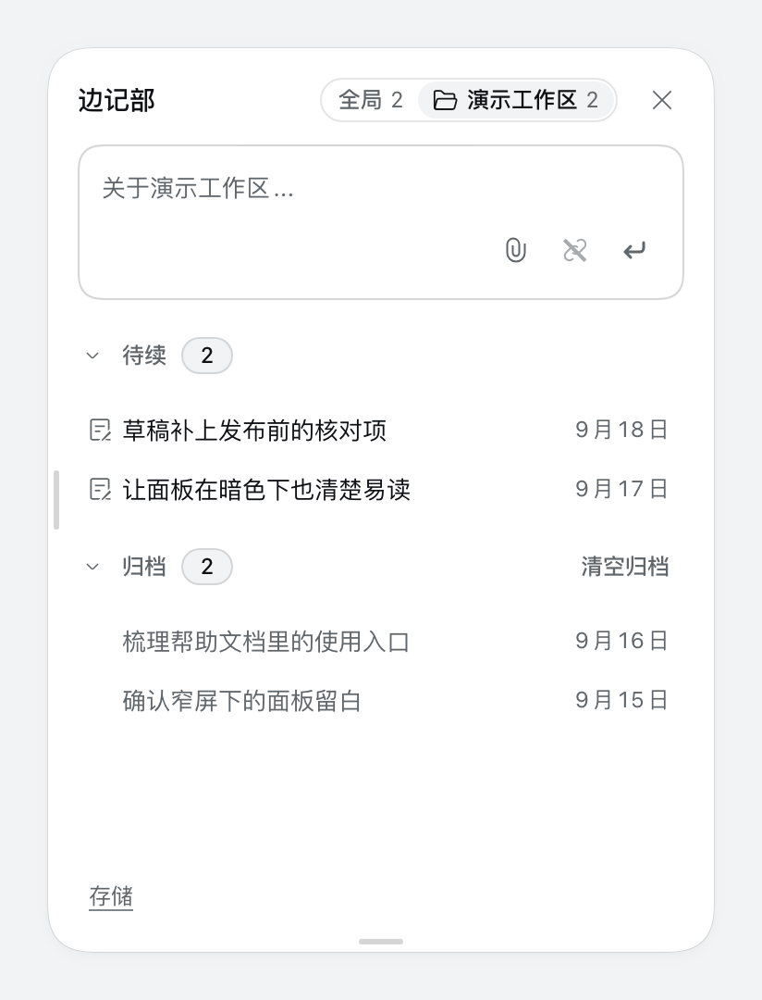
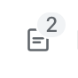
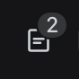

# Sideby Note · 边记部

[中文](README.md) | English

> **Personal fork notice:** Personal adaptation by [LighghtEeloo](https://github.com/LighghtEeloo) of [dsh-aside-note](https://github.com/Rayle8/dsh-aside-note) by [Rayle8](https://github.com/Rayle8). Main differences:
>
> - Display name is **Sideby Note** (边记部); the npm package is `@miorin/dsh-sideby-note` and the plugin ID is `dsh-sideby-note`.
> - **Analytics removed:** no Tencent Cloud RUM SDK, reporting code, or analytics setting is included.
> - Keeps `dsh.aside-note.*` storage keys and migrates legacy session notes automatically; screenshots below show this fork.

Sideby Note is a lightweight workspace notes panel for DeepSeek Harness (DSH).
Jot down follow-ups and attachments (up to 10 files, 25 MiB each) beside the conversation, filter by **Workspace** or **Global**, and click **Insert** to append a note to the active chat draft and archive it.

## Screenshots

The screenshots show the Chinese interface.

| | Light | Dark |
| --- | --- | --- |
| Notes panel |  |  |
| Top-right button |  |  |

## Install and use

Install into your DSH profile from the command line (or enable via **Continuity Modular Improvement Plan**; re-run the command to upgrade from unscoped `dsh-sideby-note`):

```sh
npx @miorin/dsh-sideby-note install
```

Click the **Sideby Note** button at the top right of a conversation (or press `Mod+E`; `Mod+Alt+E` in macOS and Windows browsers), type a note, and press `Enter` to save.
Click **Insert** to append text and attachments to the chat input and archive the note, or **Rewind** to edit it again.
Notes persist in the host file `~/.dsh/storages/aside_note.json` (with browser fallback), while unsent drafts and panel size stay in the current browser.

[Project documentation](docs/README.md) · [Behavior spec](docs/behavior.md) · [Changelog](CHANGELOG.md) · [MIT License](LICENSE)
