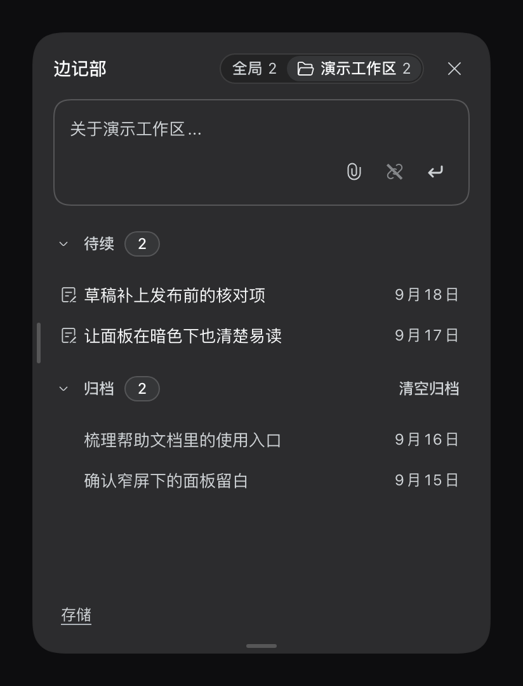

# Sideby Note · 边记部

Asynchronously draft your ideas while the agent is working

[中文](README.md) | English

> **Personal fork notice:** This is a personal adaptation by [LighghtEeloo (光吟)](https://github.com/LighghtEeloo) of [dsh-aside-note](https://github.com/Rayle8/dsh-aside-note) (旁边记 / AsideNote), the original project by [Rayle8 (阿三石)](https://github.com/Rayle8); most of the text below is preserved from the original README. Main differences from the original:
>
> - Display name and copy are **Sideby Note** (边记部); the npm package and update channel use `@miorin/dsh-sideby-note`, and the plugin ID is `dsh-sideby-note`, installed with `npx @miorin/dsh-sideby-note install`.
> - **Anonymous feature statistics removed:** the Tencent Cloud RUM SDK, reporting code, Settings › Privacy switch and related local storage keys are gone, so no usage events are sent.
> - Storage keys keep the upstream `dsh.aside-note.*` names. Upgrades automatically migrate legacy session notes.
> - The README screenshots come from this fork, not upstream.

[Sideby Note source code](https://github.com/miorin-chan/dsh-sideby-note)

Jot it down · Open as needed · Tuck it away

Sideby Note is a lightweight workspace notes plugin for DeepSeek Harness (DSH).
Keep passing thoughts and follow-ups beside the conversation, bring them back to the chat input when needed,
then tuck the panel away and carry on.

## Preview and entry

The panel separates open and archived notes. The Sideby Note button at the top right shows the open count.
The screenshots show the Chinese interface.

| | Light | Dark |
| --- | --- | --- |
| Notes panel |  |  |
| Top-right button |  |  |

Clicking the entry opens a fixed panel on the right. In a blank new session, the button sits in the top-right
corner beside the right-sidebar control. **Global** is available there, and **Workspace** is available
when the session is bound to a workspace.

## Quick install

Sideby Note installs into a DSH profile as the npm package `@miorin/dsh-sideby-note`. Pick one: hand the prompt to an agent, or run a single command.

### Install with an agent

Give your agent this block:

```text
Install the DSH plugin Sideby Note by running: npx -y @miorin/dsh-sideby-note install
No DSH restart is needed afterwards: the 边记部 entry is at the top right of the conversation.
If it is missing, tell me to refresh the Plugins page and switch the plugin off and on once.
If it says DSH or a profile cannot be found, tell me to install and start the DeepSeek Harness
client first and retry; do not clone the repo, hand-assemble dependencies, or restart DSH.
```

### Install from the command line

```bash
npx @miorin/dsh-sideby-note install
```

The installer finds the DSH profile (`DSH_PROFILE_DIR` or `~/.dsh/profiles/desktop`) and backs up its
`package.json` and `pnpm-lock.yaml` into `.local-backup/`. It adds `@miorin/dsh-sideby-note` to the dependencies
and `dsh.profile.bundles`, runs `pnpm install`, and verifies the installed `client/client.js`.
It prefers the node and pnpm that ship with DeepSeek Harness and falls back to pnpm on PATH.
Use `DSH_RUNTIME_DIR` to specify a runtime. Using the host's pnpm avoids `ERR_PNPM_UNEXPECTED_STORE` on the next
host install when the store layout differs between pnpm major versions.

```bash
npx @miorin/dsh-sideby-note install --profile work    # pick a profile
npx @miorin/dsh-sideby-note install --dry-run         # print the plan, write nothing
npx @miorin/dsh-sideby-note install --version 0.1.0   # pin the version instead of ^0.1.0
```

To upgrade from the unscoped `dsh-sideby-note`, run the install command above. The installer backs up the
selected profile and replaces its old dependency and bundle selection. Notes and attachments remain available
from their existing storage. The old in-app updater cannot switch package names.

It is safe to re-run. No restart is needed: DSH re-composes the profile within about a second, and the 边记部 entry appears at the top right of the conversation. If it does not, refresh the sidebar **Plugins** page and toggle the plugin off and on once — the running host recomposes and the entry appears.

To uninstall, drop `@miorin/dsh-sideby-note` from `dsh.profile.bundles`, run `pnpm remove @miorin/dsh-sideby-note` in the profile directory, and no restart is needed: the entry disappears right away, and if the **Plugins** page still lists it, refresh that page.

## Why Sideby Note

Working with AI often brings up things you want to revisit: a detail to change later, a result to double-check, or an idea to explore next.

Sending them straight into the conversation can interrupt the task at hand. Writing them somewhere else means finding them again later. Sideby Note keeps them beside the conversation so you can jot them down and carry on.

A few small tasks should not need a whole management system. Capture a thought, look back when you need it, and let it go when you are done. Open the panel on your terms and tuck it away afterward, with little interruption to the work at hand.

## From a quick note to the next step

### Capture it and keep going

Click the **Sideby Note** button at the top right of the conversation to open the right-side panel. Record tasks, ideas, and details to revisit. The button shows the open count.
Use **Send to Sideby Note** on the right of the chat input toolbar to move a text-only draft of up to 280 characters to the workspace’s open notes, linked to that conversation.

### Keep it in the workspace and pick it up later

**Global** shows notes from all workspaces. **Open** defaults to newest by creation time, and **Archived** to newest by archive time.
Expand either section and hover over its header to change the sort order. **By workspace** leads with the current workspace, with notes linked to the current session first within it.
Select the workspace name beside the folder icon to see only notes from that workspace.
Both filters show their open counts. The entry badge shows the current workspace count, or the global count in a standalone session.
Whichever filter you use, new notes are saved to the current workspace for its sessions to share.
In a standalone session, new notes go into a reserved unassigned workspace and appear under **Global**.

### Return to the conversation or continue here

Once a conversation starts, new notes link to that session by default. On a blank new-session page, you can take notes and unlink a draft or an existing note, but you cannot create a link. The link changes neither the note’s workspace nor its visibility or count. Below a note, use **Workspace / Session** to jump to either destination. Recalling a note for editing preserves its link or lack of one.

Use **Insert** in the current conversation for an unlinked note, or in the linked conversation for a linked one. Opening that conversation does not change its draft. **Insert** appends the text and all attachments to the draft, then archives the note. Note text starts on a new line after any existing text. Review or edit the draft and send it when you are ready.

### Small details for everyday use

- **Saved drafts**: close the panel and pick up where you left off when you reopen it; conversations in one workspace share the same draft, so switching conversations does not mean retyping.
- **Archive to look back on**: separate open and archived sections, with creation and archive times.
- **Adjustable panel**: resize the width and height, with your preferences remembered.
- **Fits into DSH**: follows the light/dark theme and all eight DSH-official languages (Chinese, English, Japanese, Spanish, French, German, Russian and Brazilian Portuguese).
- **Host-file persistence**: notes live in `~/.dsh/storages/aside_note.json`, so page refreshes, DSH restarts and a different browser all keep them; tabs in the same browser stay in sync in real time, while other browsers on the same host refresh when they open the panel. Open **Storage** in the panel footer to see the full path, copy it, or reveal the file in your file manager.

> With host storage, browsers connected to the same DSH host share notes. See [Where data lives](#where-data-lives) for the upgrade and fallback behavior.

[Quick install](#quick-install) · [Feedback and issues](https://github.com/miorin-chan/dsh-sideby-note/issues)

## Features

- **See notes across workspaces**. Under **Global**, actions on a note still save changes to the workspace that owns
  it. Tabs in the same browser stay in sync in real time.
- **Entry and panel**. The top-right button shows the open count and opens a fixed panel aligned to the button.
  The panel shifts left when the DSH right sidebar opens. Click outside to dismiss it and keep your draft.
- **Note actions**: add, reorder, copy, insert a note into the chat input, and rewind one into the composer to edit; there is no manual checkbox — inserting it archives it. Clearing archived notes asks for confirmation, and archived notes expand for review. Clearing the composer after rewinding a note removes it.
- **Attachments**: choose files with the paperclip, paste them from the clipboard, or drop them onto the note composer. A note can hold up to 10 nonempty files of up to 25 MiB each, with optional text. Select a file name to preview supported images, audio, and video. Each attachment can be downloaded, and recalling a note restores its attachments with the text.
- **Insert** adds the note’s text and original files to the open conversation’s draft, after any existing content. If the note is linked, Insert is only available in that conversation. Attachment-only notes work the same way. Once the composer accepts the complete note, it moves to **Archived**. You decide when to send. DSH applies its usual attachment limits, and the note stays open if a file cannot be read or the composer rejects the batch.
- **Drag to reorder**. Choose **Manual order** in the **Open** header, then drag a note or focus Insert and press ↑ / ↓.
  Reordering applies within the note’s own workspace. Esc cancels an active drag.
- **Remembered state**. New note drafts are saved per workspace, or per session for standalone sessions.
  Switching filters preserves the draft. Reopening the panel restores the draft, the chosen filter,
  and each section’s sort order and expanded state.
- **Panel size**: drag the left edge for width and the bottom handle for height, double-click either to reset; both persist in the browser.
- **List regions**. **Open** and **Archived** each have a sticky header and their own scroll area.
  Expanding the archive preserves the space for open notes.
  Open notes have **Insert** on the left and show **Copy** and **Rewind** on hover.
- **Storage** in the footer starts collapsed. Expand it to see the storage status and host file path.
  You can also copy the path or reveal the file in your file manager. If the connection fails
  after switching to host storage, the panel shows the reason and a **Reconnect** action.
- **Native look**: colours, radii, elevation and scrollbars all reuse DSH design tokens, following light/dark and the DSH locale; see [Design tokens](#design-tokens).

## Design tokens

See the [composer design and component reuse goals](./docs/panel-ui-rules.md#原生输入框能力与组件复用).

The panel and the entry button read from one token block in `src/client/styles/panel.css`:

| Axis | Token | Values |
| --- | --- | --- |
| Colour | `--dsw-alias-*` | DSH semantic aliases only (ink, hover, border, state, settings card); no local ramp |
| Type | `--an-fs-caption/row/title` | 12 / 13 / 14, all on a 20px line height |
| Weight | 400 / 500 | 500 is the cap; hierarchy comes from size and ink |
| Spacing | `--an-space-1 … -6` | 4 / 8 / 12 / 16 / 24 / 32 |
| Radius | `--dsw-radius-sm/md/lg/panel` + 999 | 8 (compact controls) / 16 (groups and fields) / 28 (floating panel) / pills paired with `corner-shape:round` |
| Shadow | `--dsw-elevation-panel` | the panel is `border:0`; the 0.5px hairline is the shadow's first layer |
| Material | `--dsh-an-panelSurface` (`--dsw-alias-bg-layer-2`) | opaque panel surface shared with the pinned header |
| Motion | `--ds-transition-duration*`, `--ds-ease-in-out` | 100 / 200ms, opacity and transform only |
| Scrollbar | shared theme skin | the panel rebinds `--dsh-scrollbar-*` to l2 and gives the list a 9px rail with a 2px inset |

Feedback reuses product surfaces too: copy, rewind, insert, clear-archived, and failed writes all report through a `shell.overlay` toast that outlives the panel, and icon buttons use the `ui-primitives` `Tooltip`.

## Usage

1. Click the **Sideby Note** button at the top right of the conversation to open the right-side panel.
   Select **Global** or the workspace name beside the folder icon in the panel header to filter notes.
2. Write a follow-up in the panel. Click the return button (↵) below the input or press Enter to save it.
   Press Shift+Enter for a new line.
3. To edit a note, click **Rewind** (↺) to return it to the note composer. Submitting the edit saves it in the
   note’s original workspace. Clearing the composer removes the note.
4. To reorder open notes yourself, choose **Manual order** in the **Open** header, then drag a note or focus Insert and press ↑ / ↓.
5. When you are ready to continue, click the note's **Insert** button: the text is appended to the chat input and the note is archived; review and send it yourself. Expand **Archived** to look back.
6. Use the close button, click the header toggle again, or press Esc to close. On Desktop, `Mod+E` toggles the panel (`⌘E` on macOS and `Ctrl+E` elsewhere).
   In macOS and Windows browsers, the default is `Mod+Alt+E`. Linux browsers start with no binding.
   Open the shortcut editor with `Mod+/` or **Settings › Edit shortcuts**, then find **Toggle Sideby Note** to change, clear, or restore the binding.

## Where data lives

When host storage is available, notes live in `$DSH_HOME/storages/aside_note.json`, which defaults to
`~/.dsh/storages/aside_note.json`. Open **Storage** in the panel footer to see the actual path.
After migration, the workspace table holds all notes. The host format retains the session table to read legacy data.

- The first start checks the host. If its store is empty, Sideby Note imports notes from `dsh.aside-note` and `dsh.aside-note.workspaces` and keeps the browser originals for recovery. If the host already contains notes, those lists take precedence and the browser originals remain available for recovery.
- Legacy session notes move to their owning workspaces. Notes whose workspace is unknown go into the reserved
  unassigned workspace and appear under **Global**. See the [architecture](./docs/architecture.md) for migration details.
- If the host is unavailable before the switch, Sideby Note uses browser storage and retries on the next start. Once the switch completes, an unavailable or damaged host file pauses writes. The panel shows the reason inline, with a **Reconnect** action to use once the host is available again.
- Browsers connected to the same DSH host share host-stored notes. Attachments require the host JSON backend. Their original files live in `dsh-sideby-note-attachments/` alongside `aside_note.json`, and draft references stay in the browser. Back up both together when moving between machines. Removing attachments or clearing archived notes removes their references and leaves the files on the host.
- Panel size, open/archived expansion and unsaved drafts stay in the browser. Sessions in one workspace share a draft. Standalone sessions have their own drafts.

Sideby Note uses the same host file and format as AsideNote 1.2.0. It reads existing host notes and can import from the earlier `dsh.aside-note.*` browser keys. DSH lets one plugin open the store at a time. Disable the plugin currently using the store before switching. Sideby Note pauses writes and shows a message when the store is occupied.

## Development

The Host sources live in `index.ts` and `host/`, and the Client sources live in `src/client/`.
To update a local installation, follow the [local deployment and verification SOP](./docs/auto-test-sop.md).
Back up the data first, then build, update the existing entry in the active profile, and verify it in the same UI.

```bash
npm ci         # install dependencies and build Host and Client
npm run check  # typecheck, build, test, and verify artifacts and type pins
npm run build  # regenerate index.js, host/*.js and client/client.js
npm test       # build and run all code tests
```

The entry is `src/client/index.ts`, which exports `apply(ctx)`; tsdown wraps it in DSH's loader shell:

```js
window.__ModuleLoader__.load({ id: '@miorin/dsh-sideby-note', factory: (require) => { … } })
```

The npm package ships the generated JavaScript. Git tracks the TypeScript sources and build configuration,
and CI verifies the tarball with `npm pack`, checks types, and runs the code tests.

`index.ts` registers the update and note storage routes. `cordis.patch.yml` inserts the package into the profile composition. The UI depends on two services, `slots` and `locale`.

- `conversation.composer.dock`: used only to capture the active session ID; it renders no visible entry.
- The top-right entry is injected into the host header with a MutationObserver, because the host's re-render reclaims a React portal there.

The panel mounts as its own `react-dom/client` root on `document.body` and follows the trigger with fixed positioning. All styles use DSH's `--dsw-alias-*` theme variables, so light and dark themes work.

The screenshot and preview pipeline lives in the [screenshot SOP](./docs/screenshot-sop.md): one command re-shoots both themes from an isolated profile, and credentials are not copied unless `COPY_CREDENTIALS=1`.

See the [architecture](./docs/architecture.md) for code structure, the data model and build conventions.
Expected user-visible behavior is in the [behavior rules](./docs/behavior.md).
Code tests and CI gates are documented in [testing](./docs/testing.md).

Branching, versioning and the release checklist: [release and versioning](./docs/release.md) (Chinese).

## Verification

The panel workflow is covered by integration tests:

- the **Sideby Note** button appears at the top right, with the open count on its badge;
- clicking it opens the panel on the right, aligned with the entry;
- adding updates both the badge and the panel count;
- copy, rewind into the composer, and clear-archived work in the panel; inserting a note into the chat input and drag / arrow-key reordering are driven by the jsdom integration tests;
- records survive a refresh, and the panel header switches between **Global** and **Workspace**;
- the npmjs → npmmirror → GitHub Release fallback, the one-hour cache, and the version comparison are covered by the contract tests, and the jsdom test drives the visible update notice; the live notice needs a published npm package or a GitHub Release.

Run `npm run check` for type checking, the build, automated tests and verification of build artifacts and type pins.
