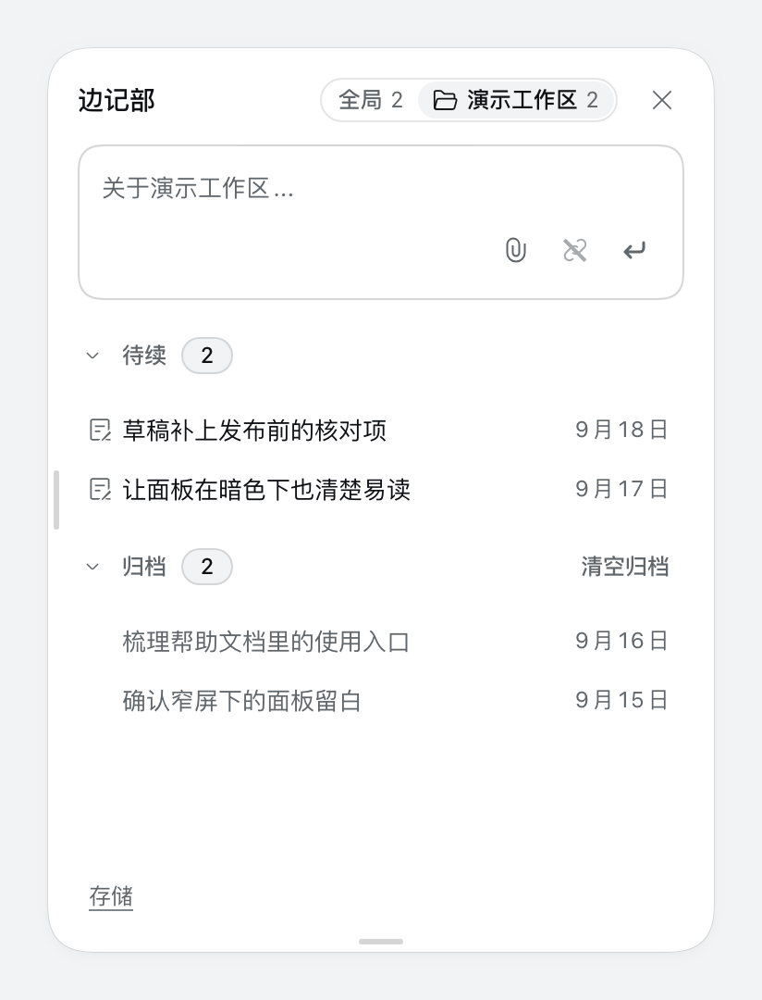
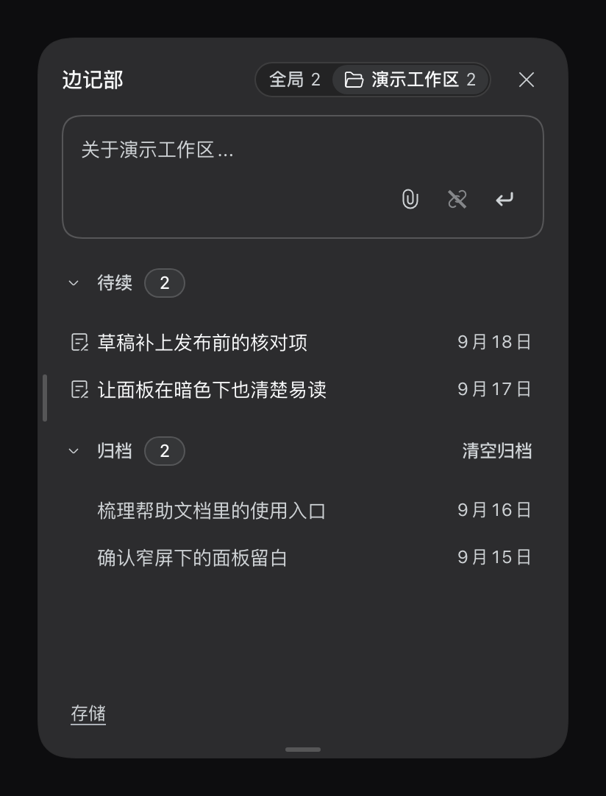

# 边记部

[English](README.en.md) | 中文

> **个人改版说明**：本项目由 [光吟（LighghtEeloo）](https://github.com/LighghtEeloo) 改版，基于 [阿三石（Rayle8）](https://github.com/Rayle8) 的 [dsh-aside-note](https://github.com/Rayle8/dsh-aside-note)（旁边记 / AsideNote），仅作个人使用。主要区别：
>
> - 中文界面名称为「边记部」；包名与更新通道为 `@miorin/dsh-sideby-note`，插件 ID 为 `dsh-sideby-note`。
> - **移除匿名统计**：不含腾讯云 RUM SDK 及相关隐私开关与存储键。
> - 沿用 `dsh.aside-note.*` 存储键，升级时自动迁移旧会话便笺；下方截图来自本改版。

边记部是面向 DeepSeek Harness（DSH）的轻量工作区便笺。
在对话旁随手记下待办或想法，支持附件（最多 10 个文件、单文件 25 MiB）、按工作区或全局筛选，需要时一键填入当前对话草稿并归档。

## 界面与入口

| | 浅色 | 深色 |
| --- | --- | --- |
| 便笺面板 |  |  |
| 右上角入口 |  |  |

## 安装与使用

通过命令行或 agent 安装进当前 profile（也可在 **脉络模块化改良计划** 中启用；从无 scope 的 `dsh-sideby-note` 升级时直接运行下方命令覆盖）：

```sh
npx @miorin/dsh-sideby-note install
```

点击会话顶部右侧的「边记部」图标（或按 `Mod+E`，macOS / Windows 浏览器为 `Mod+Alt+E`）打开面板，输入后按 `Enter` 保存。
点 **填入** 将正文与附件追加到当前对话草稿并归档，点 **退回** 可重新编辑；便笺默认写入宿主文件 `~/.dsh/storages/aside_note.json`，草稿与面板尺寸留在当前浏览器。

[项目文档](docs/README.md) · [行为规则](docs/behavior.md) · [版本日志](CHANGELOG.md) · [MIT 许可证](LICENSE)
